안녕하세요. 수수입니다.  

유명 배우가 고국에 돌아왔는데, 아무도 자신을 알아보지 못한다면 어떨까요? 팬뿐 아니라 가족에게도 잊힌다면요.

넷플릭스 일본 드라마 **〈누가 내 얘기 안 했어?〉**는 이 황당한 상황에서 출발합니다. 주인공은 **야쿠쇼 코지(잊힌 거물 배우 겐 역)**입니다. 여기에 카쿠 켄토(극작가 역), 마츠야마 켄이치(수석 조감독 역), 에구치 노리코(별거 중인 아내 역), 카와이 유미(딸 역)가 합류했습니다.

이번 글에서는 **작품의 기본 정보와 줄거리, 주요 배우 12명의 사진과 인물관계**를 정리해보겠습니다. 완주 후 감상평 대신, 공식 소개와 공개 자료를 바탕으로 한 시청 전 가이드입니다. 결말과 반전은 다루지 않습니다.

> **먼저 알고 보면 좋은 세 가지**
>
> - **총 8부작:** 회당 약 43~57분, 15세 이상 관람가.
> - **이야기의 중심:** 명성을 잃은 배우의 자존심과 재출발.
> - **출연진의 매력:** 주연급 배우부터 베테랑 조연, 코미디언까지 함께하는 앙상블.
{: .prompt-tip }

## 📺 기본 정보

| 항목 | 내용 |
|---|---|
| 한국 제목 | 누가 내 얘기 안 했어? |
| 일본 제목 | 俺のこと、なんか言ってた？ |
| 영문 제목 | Did Someone Happen to Mention Me? |
| 공개일 | 2026년 10월 22일 |
| 분량 | 8부작 · 회당 약 43~57분 |
| 관람등급 | 15세 이상 |
| 시청 | 넷플릭스 |

회차·등급은 [넷플릭스 한국 작품 페이지](https://www.netflix.com/kr/title/81915623), 공개일은 [넷플릭스 공식 발표](https://about.netflix.com/en/news/did-someone-happen-to-mention-me-main-trailer)에서 확인했습니다. 정보 확인 기준은 **2026년 11월 1일**입니다.

## 🎭 줄거리: 거물 배우가 단역부터 다시 시작한다

**타카세가와 겐(주인공·거물 배우)**은 런던의 셰익스피어 글로브 극장에서 일본인 최초로 주연을 맡은 배우입니다. 해외 무대를 성공적으로 마치고 2년 만에 돌아왔지만, 기다리던 환영은 없습니다. 세상은 물론 가족까지 그를 낯선 사람처럼 대합니다.

명성과 생활 기반을 잃은 **겐(주인공)**은 사우나에서 일하고, 촬영 현장과 오디션을 찾아다니며 다시 배우로 설 기회를 구합니다.

설정만 보면 기억을 둘러싼 미스터리가 떠오르지만, 공식 소개가 강조하는 방향은 **인정받고 싶은 사람이 밑바닥부터 다시 살아가는 휴먼 코미디**입니다. [공식 예고편 소개](https://about.netflix.com/en/news/did-someone-happen-to-mention-me-main-trailer)

## 🗺️ 인물관계, 네 갈래로 기억하세요

배우 이름을 전부 외우기보다 **겐(주인공)을 중심으로 누가 어떤 관계인지** 먼저 보면 편합니다.

| 이야기의 공간 | 함께 볼 인물 |
|---|---|
| **가족과 과거** | 마치코(별거 중인 아내), 요코(전처·기획사 대표), 에마(딸), 오모리(전 수행원·운전기사) |
| **사우나 시라카바** | 겐(주인공)과 오카모토(극작가)의 일터, 치지미(직원) |
| **극단 위스키 봉봉** | 오카모토(극작가), 무라이(간판 배우), 히사코(단원) |
| **촬영 현장** | 카와시마(수석 조감독), 미부(라이벌 배우), 카리야(엑스트라) |

아래는 [넷플릭스의 출연진 발표](https://about.netflix.com/ja/news/did-someone-happen-to-mention-me-additional-cast-announcement)와 [오리콘 인물 소개](https://www.oricon.co.jp/drama/1313/cast/)를 대조한 안내입니다. 인물 이름의 한글 표기는 자막과 일부 다를 수 있습니다.

## ⭐ 이야기의 중심 — 야쿠쇼 코지

<section class="ore-cast-card">
  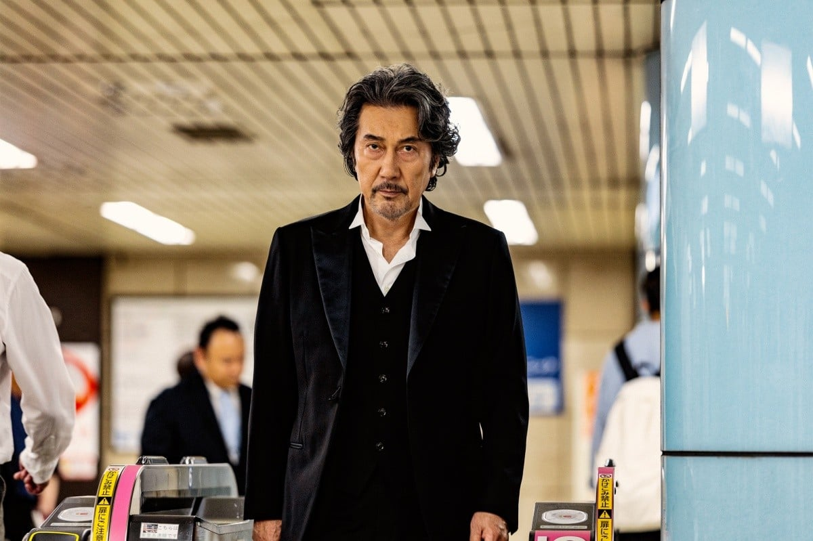
  

    <h3>야쿠쇼 코지</h3>
    
타카세가와 겐 역 · 주인공 / 잊힌 거물 배우

    
모두에게 잊힌 주인공. 과거의 명성과 현재의 처지가 부딪히는 이야기의 중심입니다.

  

</section>

## 👪 가족과 과거의 관계

<section class="ore-cast-card">
  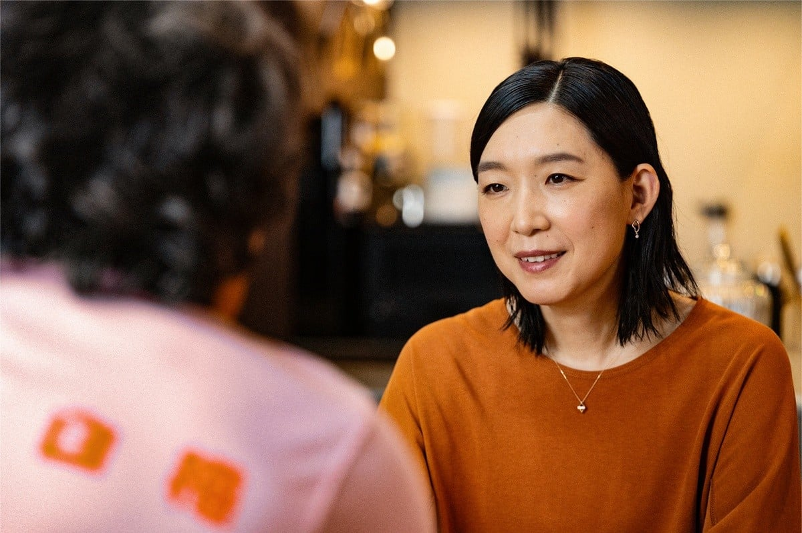
  

    <h3>에구치 노리코</h3>
    
마치코 역 · 겐과 별거 중인 아내

    
겐(주인공)과 별거 중인 아내입니다. 요코(전처·기획사 대표)와는 다른 인물입니다.

  

</section>
<section class="ore-cast-card">
  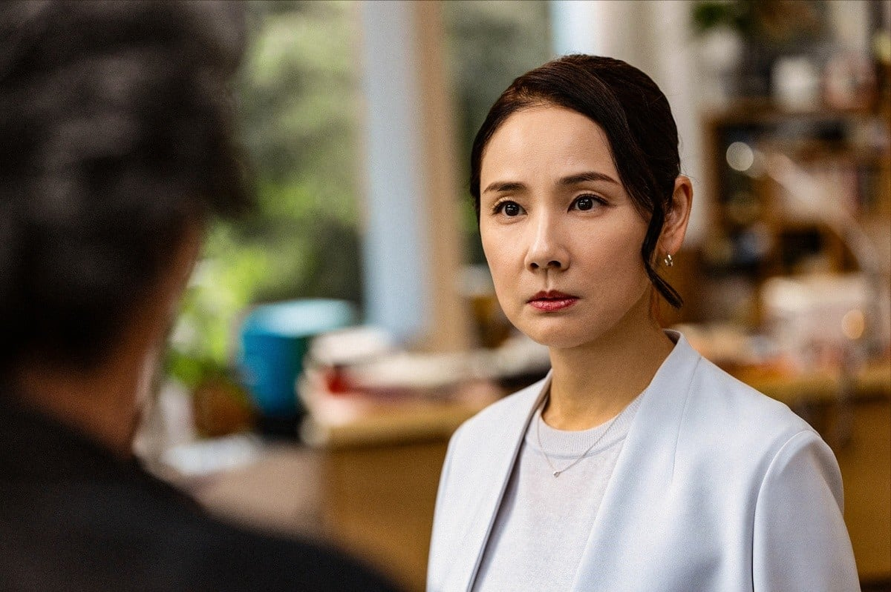
  

    <h3>요시다 요</h3>
    
노노무라 요코 역 · 겐의 전처 / 기획사 대표

    
겐(주인공)의 전처이자, 그가 속했던 연예기획사의 대표입니다.

  

</section>
<section class="ore-cast-card">
  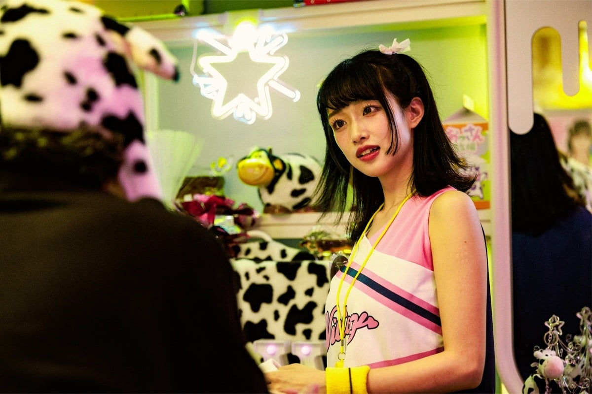
  

    <h3>카와이 유미</h3>
    
노노무라 에마 역 · 겐과 요코의 딸

    
겐(주인공)과 요코(전처·기획사 대표)의 딸입니다. 콘셉트 카페에서 일합니다.

  

</section>
<section class="ore-cast-card">
  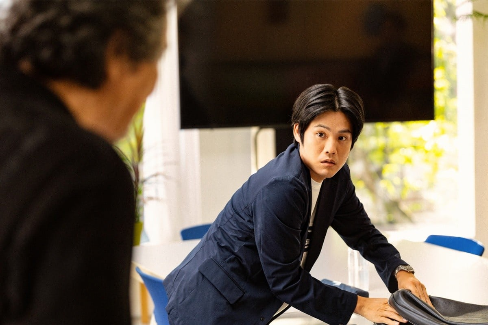
  

    <h3>카미카와 슈사쿠</h3>
    
오모리 나오토 역 · 겐의 전 수행원 / 운전기사

    
겐(주인공)의 전 수행원 겸 운전기사입니다.

  

</section>

## 🧖 사우나와 극단에서 만나는 사람들

<section class="ore-cast-card">
  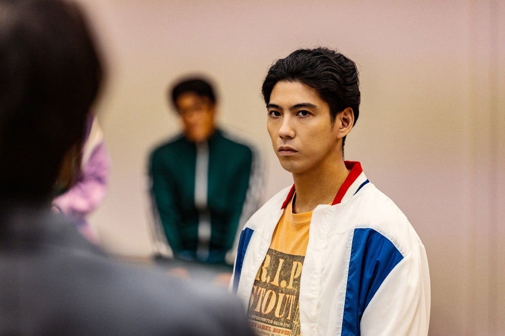
  

    <h3>카쿠 켄토</h3>
    
오카모토 테츠 역 · 극작가 / 사우나 동료

    
극단을 이끄는 극작가. 사우나에서도 일하며, 창작의 슬럼프를 겪고 있습니다.

  

</section>
<section class="ore-cast-card">
  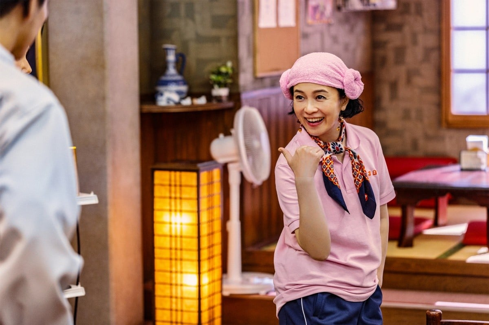
  

    <h3>사카이 마키</h3>
    
치지미 역 · 사우나 직원

    
사우나 시라카바의 직원입니다.

  

</section>
<section class="ore-cast-card">
  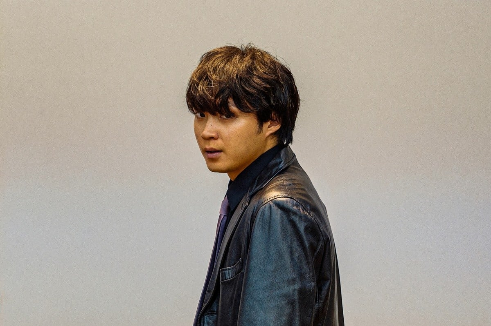
  

    <h3>이소무라 하야토</h3>
    
무라이 타케루 역 · 극단 간판 배우

    
극단의 간판 배우. 자기 도취적인 연기로 존재감을 드러내는 인물입니다.

  

</section>
<section class="ore-cast-card">
  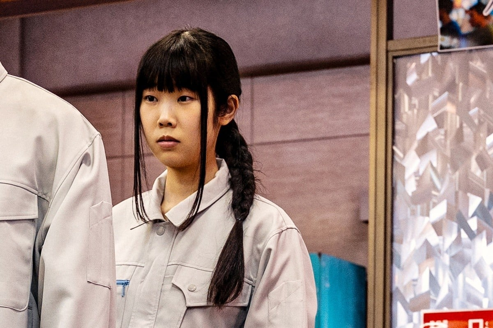
  

    <h3>나카이 치사토</h3>
    
니만다 히사코 역 · 극단 단원

    
극단 위스키 봉봉의 단원입니다.

  

</section>

## 🎬 촬영 현장의 인물들

<section class="ore-cast-card">
  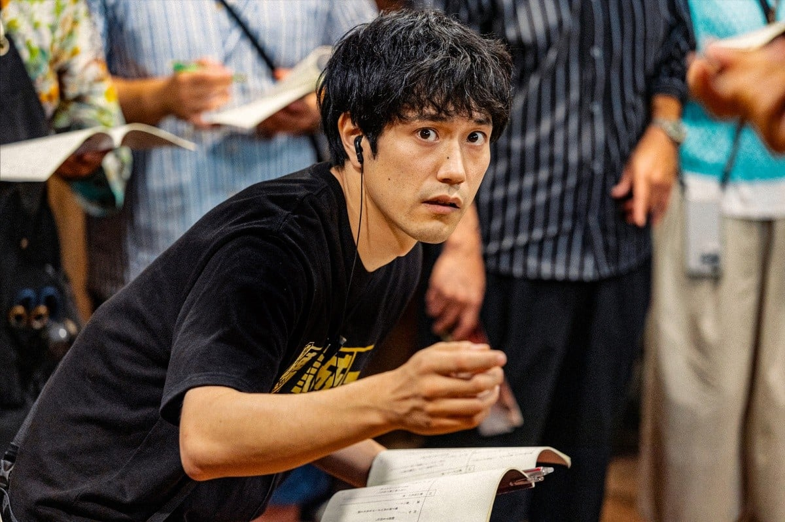
  

    <h3>마츠야마 켄이치</h3>
    
카와시마 카즈키 역 · 수석 조감독

    
촬영 현장을 책임지는 베테랑 수석 조감독입니다.

  

</section>
<section class="ore-cast-card">
  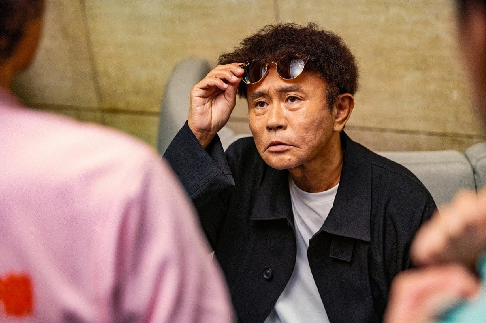
  

    <h3>하마다 마사토시</h3>
    
미부 다이야 역 · 겐의 라이벌 배우

    
겐(주인공)과 오랫동안 경쟁해온 인기 배우입니다.

  

</section>
<section class="ore-cast-card">
  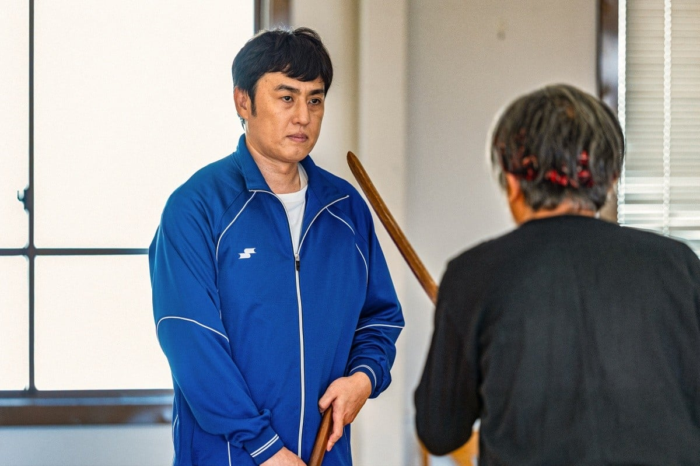
  

    <h3>야마모토 히로시</h3>
    
카리야 준이치로 역 · 베테랑 엑스트라

    
촬영 현장을 오가는 베테랑 엑스트라입니다.

  

</section>

개별 사진 출처: [ORICON NEWS 작품별 출연진 소개](https://www.oricon.co.jp/drama/1313/cast/)에 게재된 작품 스틸. 사진의 권리는 해당 권리자에게 있습니다.

## 👀 전부 다 유명 배우일까?

**출연진 모두를 같은 수준의 스타라고 부르기보다는, 주연급 배우와 실력파 조연·코미디언이 함께 모였다고 보는 편이 정확합니다.**

야쿠쇼 코지(주인공 겐 역)를 중심으로 카쿠 켄토(극작가 오카모토 역), 마츠야마 켄이치(수석 조감독 카와시마 역)가 함께합니다. 에구치 노리코(아내 마치코 역)와 요시다 요(전처·기획사 대표 요코 역)도 주요 관계를 이룹니다.

카와이 유미(딸 에마 역)와 이소무라 하야토(극단 간판 배우 무라이 역) 등 젊은 배우들도 주요 배역을 맡았습니다.

또 하마다 마사토시(라이벌 배우 미부 역)는 코미디 콤비 **다운타운**, 야마모토 히로시(엑스트라 카리야 역)는 **로버트**의 멤버입니다. 배우로만 활동해온 사람들과는 다른 경로로 대중에게 익숙한 얼굴들입니다. [출연진 경력 소개](https://www.oricon.co.jp/drama/1313/cast/)

이 작품을 소개할 때는 ‘전원 톱스타’보다 **서로 다른 분야에서 활동해온 출연진이 한 작품에 모인 점**을 짚는 것이 좋겠습니다.

## 🎟️ 특별출연도 찾아보는 재미

주요 배역 외에 특별출연진도 여럿 등장합니다. 아래는 공개 기사에서 확인한 인물들이며, 구체적인 사건과 결말은 생략했습니다.

| 출연자 | 공개된 출연 내용 |
|---|---|
| **나카노 타이가** | 극중 밀착 프로그램 내레이션, 1화 본인 출연 |
| **나마세 카츠히사·후루타 아라타** | 극중 드라마의 거물 배우들 |
| **히라타 미츠루·코히나타 후미요·츠다 칸지** | 본인 역할 출연 |

그 밖에 **미야다테 료타, 사토 호나미, 타구치 히로마사, 오쿠노 에이타, 시부야 나기사, 유미 카오루** 등의 참여도 공개됐습니다. 앞에서 사진으로 정리한 12명은 주요 배역 기준이며, 특별출연진 전체를 포함한 숫자는 아닙니다. [특별출연 공개 기사](https://eiga.com/news/20261028/5/)

## ✍️ 배우만큼 눈여겨볼 제작진

| 담당 | 이름 |
|---|---|
| 각본 | **쿠도 칸쿠로** |
| 기획·프로듀싱 | **이소야마 아키** |
| 연출 | **카네코 후미노리·사카우에 타쿠야·와타나베 아츠시** |
| 음악 | 코노 신 |
| 제작 프로덕션 | THE SEVEN |
| 제작 협력 | ROBOT |

[넷플릭스 제작진 발표](https://about.netflix.com/ja/news/did-someone-happen-to-mention-me-additional-cast-announcement)

거물 배우가 단역으로 다시 시작하고, 실제 배우들이 본인 역할로 등장한다는 점에서 **배우의 자존심과 촬영 현장을 어떻게 코미디로 풀어내는지**가 궁금해지는 조합입니다. 이는 공개 설정을 바탕으로 한 관전 포인트이며, 연출이나 연기 완성도에 대한 감상평은 아닙니다.

## 🔍 인물관계를 알고 보면 보이는 세 가지

다음은 공개된 설정에서 짚어볼 수 있는 관전 포인트입니다. 실제 장면에 대한 감상이나 결말 해석은 아닙니다.

### 1. 배우로서의 자존심과 당장의 생계

**겐(주인공·거물 배우)**에게는 성공했던 기억이 있지만, 주변 사람들은 그 명성을 인정하지 않습니다. 사우나에서 일하거나 단역을 구해야 하는 현재와, 자신이 기억하는 과거 사이에 간격이 생깁니다.

여기서 궁금해지는 것은 그가 어떤 대우를 받느냐뿐 아니라 **낯선 환경에서 다른 사람을 어떻게 대하느냐**입니다. 명성이 사라진 뒤의 태도가 인물을 이해하는 단서가 될 수 있겠습니다.

### 2. 서로 다른 방식으로 인정받고 싶은 사람들

**오카모토(극작가)**는 창작의 슬럼프를 겪고, **무라이(극단 간판 배우)**는 자기 도취적인 연기를 보여주는 인물로 소개됩니다. **미부(겐의 라이벌 배우)**는 이미 인기를 누리는 위치에 있습니다.

이들을 함께 놓으면 인정받고 싶은 마음에도 여러 모습이 있다는 점을 생각해볼 수 있습니다. 겐(주인공)만 따라가기보다 **각 인물이 누구에게 무엇을 인정받고 싶어 하는지** 살펴보면 관계를 기억하기도 쉽겠습니다.

### 3. 무대 위 배우와 촬영 현장 사람들의 시선

**카와시마(수석 조감독)**와 **카리야(베테랑 엑스트라)**는 배우를 둘러싼 현장의 다른 자리를 보여주는 인물입니다. 같은 촬영이라도 주연, 조감독, 엑스트라가 중요하게 여기는 것은 다를 수 있겠죠.

겐(주인공)이 다시 일을 시작하는 과정을 통해 **누가 주목받고, 누가 그 장면을 떠받치는지** 함께 보는 것도 이 설정을 즐기는 방법이겠습니다.

## ❓ 보기 전에 궁금한 점

**무서운 미스터리인가요?**  
‘모두가 한 사람을 잊었다’는 출발점은 기묘하지만, 넷플릭스는 작품을 인간미 있는 코미디로 소개합니다. 설정의 수수께끼뿐 아니라 겐(주인공)의 재출발과 주변 인물들과의 관계를 중심에 두고 접근하면 좋겠습니다. [공식 작품 소개](https://www.netflix.com/kr/title/81915623)

**마치코와 요코는 같은 사람인가요?**  
다른 인물입니다. **마치코(별거 중인 아내·에구치 노리코)**와 **요코(전처이자 기획사 대표·요시다 요)**를 구분해두세요. **에마(딸·카와이 유미)**는 겐(주인공)과 요코(전처)의 딸입니다. [공식 출연진 소개](https://about.netflix.com/ja/news/did-someone-happen-to-mention-me-additional-cast-announcement)

**일본 배우를 잘 몰라도 볼 수 있을까요?**  
이 가이드에서는 배우의 유명세보다 **극중 관계와 직업을 먼저 알아두는 방식**을 권하고 싶습니다. 특별출연자의 실제 이름을 알아보는 재미는 별도로 두고, 처음에는 사진과 역할을 함께 확인하면 인물을 따라가는 데 도움이 되겠습니다.

## 💭 보기 전에 기억할 것

인물이 많아 처음에는 이름이 헷갈릴 수 있습니다. **겐(주인공)의 가족, 사우나 동료, 극단 사람들, 촬영 현장 사람들**이라는 네 갈래로 기억해보세요. 얼굴이 익지 않은 배우는 위 사진에서 다시 확인하면 됩니다.

무엇보다 흥미로운 질문은 이것입니다. **사람들이 내 이름을 잊어버렸을 때, 나에게 남는 것은 무엇일까?** 주인공이 되돌아가고 싶은 자리가 어디인지 생각하며 보면 작품의 출발점을 이해하기 좋겠습니다.

[넷플릭스에서 〈누가 내 얘기 안 했어?〉 보기](https://www.netflix.com/kr/title/81915623)

---

대표 이미지 출처: [Netflix 공식 출연진 공개 자료](https://about.netflix.com/ja/news/did-someone-happen-to-mention-me-additional-cast-announcement). 개별 인물 사진은 본문의 오리콘 출처를 참고했습니다.
